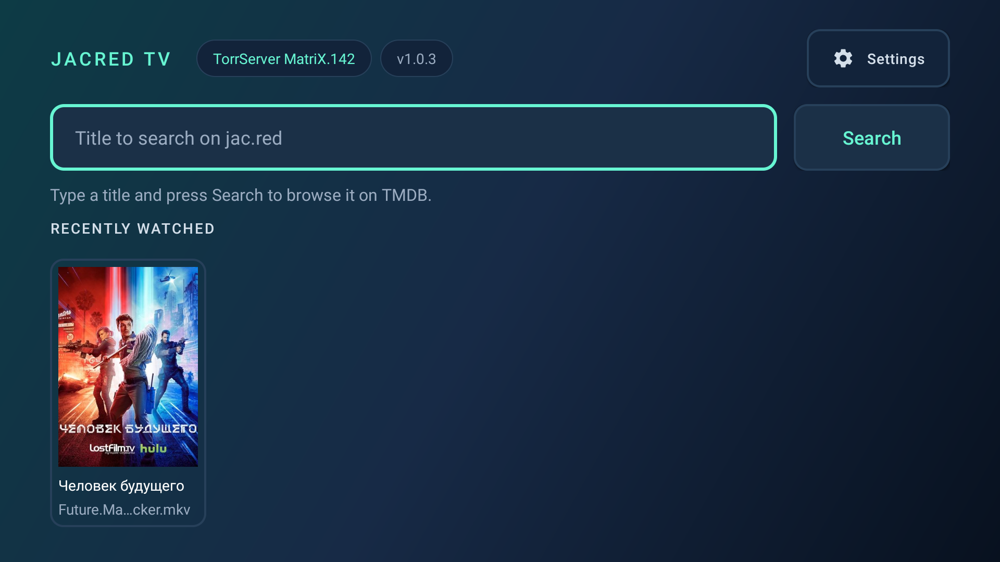
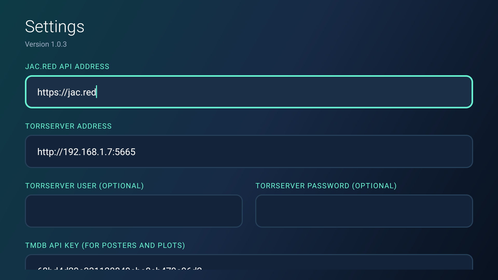
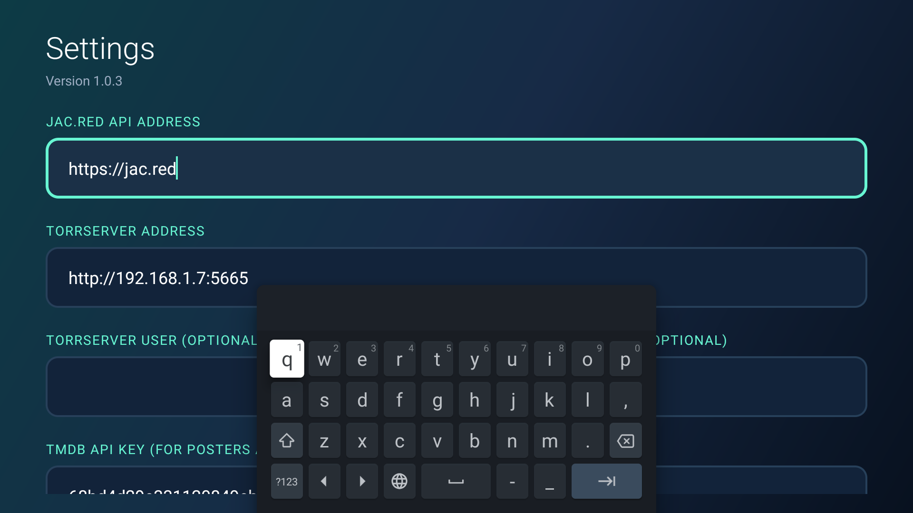
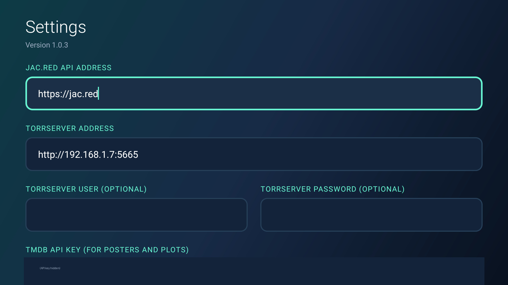

# JacRed TV

A native Android TV client that searches [jac.red](https://jac.red), streams the chosen
release through a [TorrServer](https://github.com/YouROK/TorrServer) on the local network,
and hands the stream to a video player already installed on the box. It is built for a
Xiaomi Mi Box 4 and driven entirely with a TV remote — there is no touch UI.

**Browse** (TMDB titles) → **releases** (jac.red, with filters) → **detail** (TorrServer
files, Watch / Keep / Remove).

The app has no third-party dependencies: Android framework, `org.json` and
`HttpURLConnection` only. A build never needs to resolve an external artifact.

| Property | Value |
| --- | --- |
| Application id | `tv.jacred.client` |
| Min / target SDK | 28 / 34 |
| Permissions | `INTERNET`, `ACCESS_NETWORK_STATE` |
| Launcher | Android TV Leanback, landscape |
| Languages | English and Russian, chosen by the television's own locale |

## Screens

| | |
| --- | --- |
|  **Home** — search box, TorrServer and version chips, recently-watched row |  **Titles** — TMDB poster wall for the query |
|  **Releases** — jac.red results with sort and facet filters |  **Detail** — TorrServer file list, Watch / Keep / magnet |



**Settings** — jac.red and TorrServer addresses, TMDB credentials, default player, and
**Check for updates**. Captured on the Mi Box at 1080p; the TMDB key is painted out.

## Requirements

- JDK 17 and the Android SDK (platform 34, build-tools). Android Studio brings both.
- A TorrServer reachable from the TV. Everything except playback works without it.
- Optional: a TMDB API key. Without one the app skips the poster grid and searches jac.red
  directly — no artwork, no plots, everything else unchanged.

## Build

```sh
./gradlew assembleDebug      # app/build/outputs/apk/debug/app-debug.apk
./gradlew assembleRelease    # app/build/outputs/apk/release/app-release.apk
./gradlew lintDebug          # lint is a build gate: warnings are an error
```

The release build is minified and resource-shrunk by R8. Keep
`app/build/outputs/mapping/release/mapping.txt` for any build you hand to someone else —
it is the only way to read a stack trace from a shrunk APK afterwards.

### Signing a release

Signing material stays out of the repository. Create a keystore once:

```sh
keytool -genkeypair -v -keystore jacred-tv.jks -alias jacred \
  -keyalg RSA -keysize 4096 -validity 10000
```

Then copy `keystore.properties.sample` to `keystore.properties` in the project root and
fill it in. `assembleRelease` picks it up automatically; without it the task still runs and
produces `app-release-unsigned.apk`, which no device will install until it is signed by
hand with `apksigner`.

`keystore.properties`, `*.jks` and `*.keystore` are git-ignored. Losing the keystore means
no future build can update an installed copy of the app.

## Install on the TV

```sh
export PATH="$PATH:$HOME/Library/Android/sdk/platform-tools"   # if adb is not on PATH
adb connect 192.168.1.128:5555                                 # the Mi Box's address
adb -s 192.168.1.128:5555 install -r app/build/outputs/apk/release/app-release.apk
adb -s 192.168.1.128:5555 shell am start -n tv.jacred.client/.MainActivity
```

`install -r` keeps the app's saved settings and history. The box's IP comes from the local
network and can change — check **Settings → Network & Internet** on the TV if the connect
fails, and make sure no VPN is isolating local traffic on the computer.

## Configure

Everything is set on the app's own **Settings** screen, which is reached from the home
screen or from a release's detail screen:

| Field | Default | Notes |
| --- | --- | --- |
| jac.red API address | `https://jac.red` | Needs no key on the public host. |
| TorrServer address | `http://192.168.1.7:5665` | Plain http on the LAN is expected. |
| TorrServer user / password | empty | Only if the server has auth enabled. |
| TMDB key / API / image address | TMDB's own hosts | **Import TMDB from TorrServer** copies whatever the server already stores; **Use image mirror** switches to `imagetmdb.com` where `image.tmdb.org` is blocked. |
| Default video player | Ask every time | Any installed app that can open a video stream. |

**Test TorrServer** reports the server's version, which is the quickest check that the
address and credentials are right.

Settings and watch history are kept in app-private storage and are excluded from cloud
backup and device-to-device transfer: they contain server credentials and an API key.

## How it talks to each service

- **jac.red** — `GET /api/v1.0/torrents?search=&sort=seeders` is primary; it matches titles
  far better than the Jackett-compatible endpoint. `GET /api/v2.0/indexers/all/results`
  is the fallback and the only one carrying `ffprobe` stream details, so resolution and
  codec come from the file itself rather than the tracker's claim. The **API** chip on the
  releases screen switches between them.
- **TorrServer** — `POST /torrents` with an `action` of add/get/rem,
  `GET /stream/<name>?link=<hash>&index=<id>&play` for one file,
  `GET /playlist/playlist.m3u?hash=` for a whole season, `POST /viewed` for watch marks,
  `GET /echo` for the version and `GET /tmdb/settings` for the Settings import.
- **TMDB** — `search/multi` only, and only when a key is set. Lookups happen once per
  search, never per result row.

## Project layout

```
app/src/main/java/tv/jacred/client/
  MainActivity        search box, TMDB poster grid, recently-watched row, server chip
  ReleasesActivity    jac.red releases for one title, with sort and facet chips
  DetailActivity      adds the magnet to TorrServer, lists files, plays them
  SettingsActivity    addresses, credentials, keys, default player
  JacRed / Torrent / Filters      search, parsing, in-memory narrowing
  TorrServer / TorrStatus / TorrFile   TorrServer API client
  Tmdb / ImageLoader              artwork
  Http / Ui / Prefs / History / Players / TvDialog   shared plumbing
app/lint.xml          every lint finding that is deliberately ignored, with a reason
app/proguard-rules.pro  R8 configuration for the release build
```

## Remote-control rules

Every control must be reachable and visibly focusable with the D-pad; nothing may depend on
touch. Layouts stay landscape and are designed for a ten-foot viewing distance. Text fields
never open the on-screen keyboard on focus — while that keyboard is up it swallows the
D-pad — they open it on OK instead.
